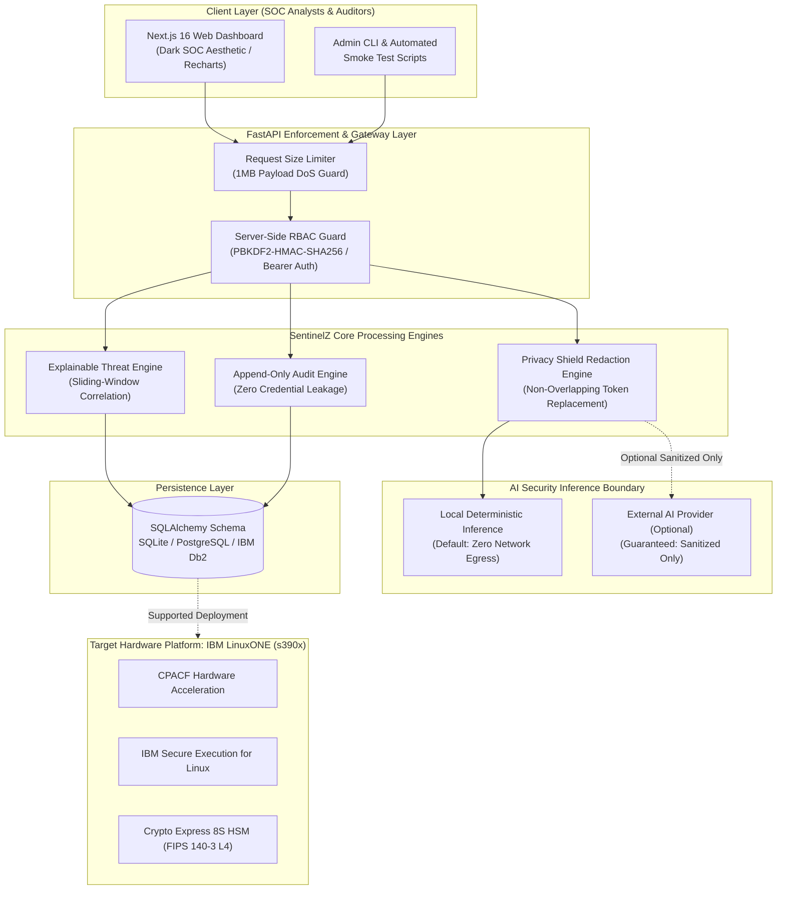
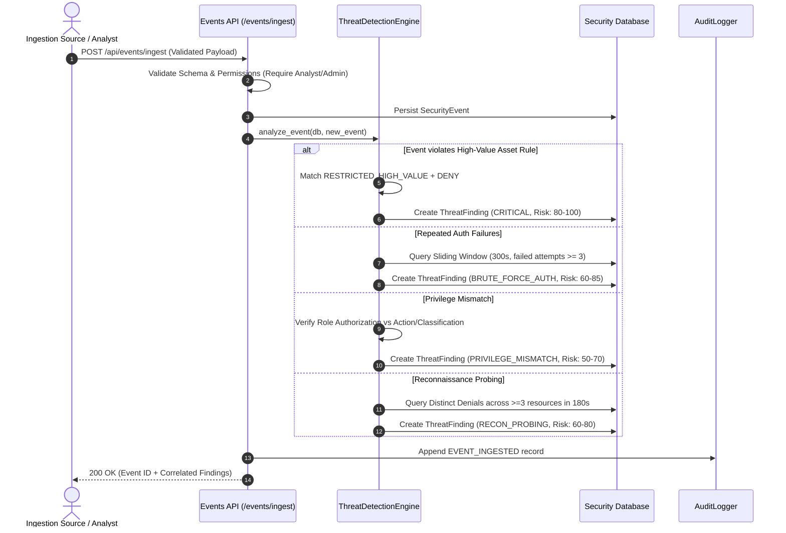
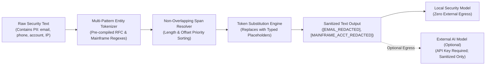
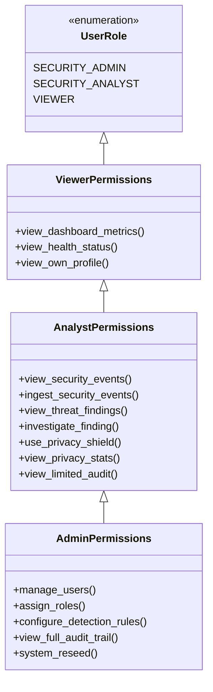

# SentinelZ AI — System Architecture Specification
**Platform:** SentinelZ AI — Privacy-First AI Security & Threat Detection Platform  
**Tagline:** *Intelligence Without Exposure*  
**Theme:** IBM Z Datathon 2026 — *AI Secured: Innovation Without Exposure*  

---

## 1. Executive Architecture Overview

SentinelZ AI is designed for enterprise Security Operations Centers (SOCs) handling sensitive customer records, financial ledgers, and critical infrastructure (e.g., hybrid IBM zSystems and LinuxONE mainframes). 

The platform enables security analysts to ingest high-velocity security events, detect sophisticated threat patterns through explainable deterministic rules, and run AI-assisted threat summaries **without exposing personally identifiable information (PII) or confidential infrastructure tokens to external models or unvetted processes**.

---

## 2. Core Architectural Subsystems

### 2.1 Threat Detection Engine Flow
The Threat Detection Engine processes incoming security events in real-time, cross-referencing recent sliding-window state to generate explainable security findings.

#### Deterministic Risk Scoring Formula
$$\text{RiskScore} = \min\left(100.0, \text{BaseRuleWeight} + (\text{EventCount} \times 3.5) + \text{ClassificationBonus} + \text{DenialPenalty}\right)$$

- **Base Weights:**
  - `HIGH_VALUE_UNAUTHORIZED`: 55.0
  - `BRUTE_FORCE_AUTH`: 45.0
  - `RECON_PROBING`: 40.0
  - `PRIVILEGE_MISMATCH`: 35.0
  - `RATE_ANOMALY`: 30.0
- **Classification Bonuses:**
  - `RESTRICTED_HIGH_VALUE`: +25.0
  - `CONFIDENTIAL`: +15.0
  - `INTERNAL`: +5.0
- **Denial Penalty:** +10.0 if access was rejected.

---

### 2.2 Privacy Shield Boundary & Data Flow
The Privacy Shield acts as a non-negotiable gateway between raw telemetry and AI models.

#### Span Overlap Protection Algorithm
To prevent text corruption when multiple recognizers match overlapping character ranges (e.g., an account string adjacent to an IP or a phone number containing digits resembling a credit card):
1. Matches are harvested as `MatchedSpan(entity_type, placeholder, start, end, matched_text)`.
2. Spans are sorted by `start` ascending, and by `length` descending.
3. A single-pass pruning filter checks `span.start >= last_end`; overlapping sub-spans are deterministically discarded.
4. Token substitutions are executed from **highest character offset to lowest** (`reverse=True`), preserving byte indices for preceding substrings.

---

### 2.3 Role-Based Access Control (RBAC) Architecture
All protected endpoints enforce server-side dependency injection (`require_roles`):

---

### 2.4 Immutable Audit Trail Architecture
1. **Append-Only Behavior:** The API provides only `POST` and `GET` verbs for audit records. No `UPDATE` or `DELETE` endpoints exist in the application.
2. **Zero-Leakage Sanitization:** The `AuditLoggerService.sanitize_metadata()` method recursively scans context payloads and replaces any key matching forbidden tokens (`password`, `token`, `secret`, `key`, `raw_text`, `unredacted`) with `[REDACTED_SECURITY_CONTROL]`.
3. **Correlation Tracking:** Every operational request receives an immutable correlation ID (`req_<uuid>`), enabling end-to-end tracing across services.

---

## 3. IBM Z / LinuxONE Architectural Alignment

### 3.1 Software Compatibility
- **Runtimes:** Python 3.11–3.14 (neutral architecture, no x86 C-extension constraints) and Node.js LTS (v20–v24).
- **Zero Binary Lock-in:** The backend uses standard Python library cryptography (`hashlib.pbkdf2_hmac` with SHA-256 and `secrets.token_hex`), avoiding third-party compiled wheels (such as older `bcrypt` versions) that can experience build failures on `s390x`.
- **Database Abstraction:** Built on SQLAlchemy 2.0 with standard SQL types, easily connecting to local SQLite in development and enterprise **IBM Db2** or **PostgreSQL** on IBM LinuxONE.

### 3.2 Platform Security Capabilities vs Application Controls

| Layer | SentinelZ Application Control (Implemented) | IBM LinuxONE Platform Capability (Deployment Target) |
| :--- | :--- | :--- |
| **Data in Transit** | TLS 1.3 termination, strict CORS headers | **CPACF Acceleration:** Hardware-accelerated AES/SHA on z15/z16 cores |
| **Data at Rest** | Typed PII placeholder redaction, zero plaintext secrets | **Pervasive Encryption:** Transparent full-disk and dataset encryption |
| **Compute Boundary** | In-memory session validation, server-side RBAC | **IBM Secure Execution for Linux:** TEE enclaves protecting against host snooping |
| **Key Storage** | Architecture-neutral PBKDF2 with 100k rounds | **Crypto Express 8S HSM:** FIPS 140-3 Level 4 tamper-resistant cryptographic keys |
| **Auditing** | Append-only SQLite/PostgreSQL audit tables with correlation IDs | **IBM z/OS SMF / Linux on Z auditd:** Immutable hardware-clocked audit logs |
