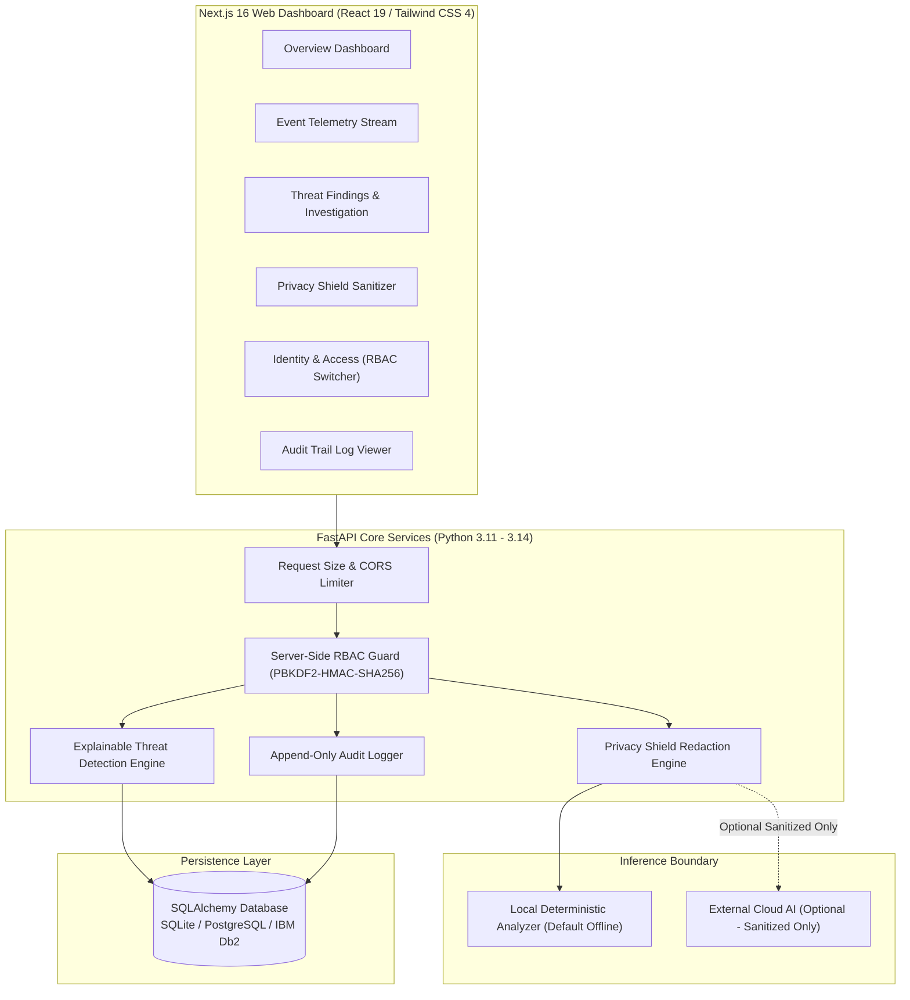

# SentinelZ AI — Privacy-First AI Security & Threat Detection Platform
> **Tagline:** *Intelligence Without Exposure*  
> **IBM Z Datathon 2026 Theme:** *AI Secured: Innovation Without Exposure*  
> **Live IBM LinuxONE Deployment:** **[http://148.100.98.222](http://148.100.98.222)** (Running on Ubuntu 24.04 s390x)  
> **Deployment Guide:** [`docs/DEPLOYMENT_GUIDE.md`](docs/DEPLOYMENT_GUIDE.md)  
> **Target Architecture:** IBM LinuxONE / Linux on IBM Z (`s390x`) & Cross-Platform (`x86_64`)

---

## 1. Problem Statement

Modern enterprise Security Operations Centers (SOCs) monitoring hybrid cloud and mainframe infrastructure face a fundamental dilemma:
- Analysts need the power of AI to synthesize voluminous logs, detect anomalous patterns, and evaluate complex security events.
- However, raw security telemetry contains highly sensitive information: corporate emails, customer phone numbers, mainframe ledger account numbers, internal IP topologies, and employee identifiers.
- Exposing raw telemetry to external LLMs or unvetted cloud services violates regulatory mandates (GDPR, HIPAA, PCI-DSS) and risks operational reconnaissance by adversaries.
- Many existing AI security tools also act as opaque black boxes, assigning arbitrary risk scores without explainable evidence.

---

## 2. Solution Overview

**SentinelZ AI** is a fully functional, demonstrable security and threat detection prototype that proves enterprise security analytics can deliver deep actionable intelligence without exposing sensitive underlying data:
1. **Explainable Threat Detection:** Detects credential abuse, privilege mismatches, rate bursts, reconnaissance probing, and unauthorized mainframe asset access using deterministic, auditable rules.
2. **Dedicated Privacy Shield:** Intercepts sensitive tokens on the backend, applies non-overlapping typed replacement masks (`[EMAIL_REDACTED]`, `[MAINFRAME_ACCT_REDACTED]`, `[IP_REDACTED]`), and verifies that unredacted PII never reaches AI models.
3. **Local-First AI Execution:** Defaults to a deterministic local security inference engine with zero outbound network egress.
4. **Server-Enforced RBAC:** Implements strict three-tier role-based access control (Security Administrator, Security Analyst, and Viewer) with deny-by-default logic and privilege escalation defense.
5. **Immutable Governance Audit Trail:** Records all security operations with correlation IDs and automated scrubbing of secrets and tokens.
6. **IBM LinuxONE Readiness:** Designed with architecture-neutral Python standard libraries and web runtimes, verified for deployment on Linux on IBM Z (`s390x`).

---

## 3. Key Product Features

| Module | Core Functionality |
| :--- | :--- |
| **Security Operations Dashboard** | Live KPI metrics (Total Events, High-Risk Events, Under Investigation, Denied Access, PII Shielded count), temporal volume charts, severity breakdown, and real-time audit feed. |
| **Security Event Ingestion** | Validated ingestion endpoint (`/api/events/ingest`) with size limiting (1MB max), malformed payload rejection, preset threat scenario templates, and real-time engine evaluation. |
| **Explainable Threat Findings** | Rule-correlated alerts with deterministic 0–100 risk scoring, human-readable explanations, evidence payloads, and non-destructive investigation steps. |
| **Incident Investigation** | Finding details page with timeline, affected synthetic identity, and audited status triage workflow (`OPEN` &rarr; `INVESTIGATING` &rarr; `RESOLVED` / `FALSE_POSITIVE`). |
| **Privacy Shield** | Multi-span PII detection and redaction (emails, phones, IBM mainframe accounts, credit cards, SSNs, IP addresses, custom keywords) with span overlap protection and safe AI dispatch. |
| **Identity & Access (RBAC)** | Strict server-side RBAC enforcement, user role management, and an interactive Datathon Persona Switcher (Admin, Analyst, Viewer). |
| **Audit Trail** | Append-only governance log recording all security actions with correlation IDs, client IPs, and strict scrubbing of credentials. |
| **System Health & LinuxONE** | Live liveness (`/api/health`) and readiness (`/api/readiness`) probes, runtime metadata, and documented IBM Z security alignment. |

---

## 4. Architecture



---

## 5. Prerequisites & Environment

- **Python:** 3.11, 3.12, 3.13, or 3.14
- **Node.js:** v20.x, v22.x, or v24.x LTS
- **npm:** 10.x or 11.x
- **OS:** Linux (s390x / x86_64), macOS, or Windows (PowerShell)

---

## 6. Local Setup & Execution

### Step 1: Install Dependencies
```bash
# Backend dependencies
pip install -r backend/requirements.txt

# Frontend dependencies
npm install
```

### Step 2: Configure Environment Variables
```bash
cp .env.example .env
```
*(The default configuration has `SENTINELZ_AI_ENABLED=false` for 100% offline local privacy).*

### Step 3: Start the Backend Service
```bash
python -m uvicorn backend.app.main:app --host 0.0.0.0 --port 8000 --reload
```
The FastAPI backend will automatically initialize the database schema and seed 45+ realistic synthetic events, threat scenarios, and demo accounts.
- API Documentation (Swagger): `http://localhost:8000/api/docs`
- Health Probe: `http://localhost:8000/api/health`

### Step 4: Start the Frontend Dashboard
In a separate terminal:
```bash
npm run dev
```
Open your browser to: `http://localhost:3000`

---

## 7. Demo Accounts & Credentials

The application includes 3 pre-seeded demo personas accessible via password login or the 1-click **Datathon RBAC Switcher** in the sidebar:

| Persona | Email | Password | Role & Permissions |
| :--- | :--- | :--- | :--- |
| **Security Administrator** | `admin@sentinelz.local` | `SentinelAdmin#2026` | Full administrative control, user role management, rule configuration, and system re-seeding. |
| **Lead SOC Analyst** | `analyst@sentinelz.local` | `SentinelAnalyst#2026` | Security event ingestion, threat finding investigation, status disposition, and privacy shield execution. |
| **Compliance Viewer** | `viewer@sentinelz.local` | `SentinelViewer#2026` | Read-only access to aggregate metrics. Denied event ingestion, finding details mutation, and administrative routes. |

---

## 8. Automated Testing & Verification

SentinelZ AI includes a comprehensive, deterministic Pytest test suite covering all critical security requirements:

```bash
python -m pytest backend/tests -v
```

### Automated Smoke Test Script
To verify a running instance:
```bash
python scripts/smoke_test.py
```

### Verified Test Cases (24 Tests, 100% Pass Rate):
1. **Threat Rules:** Validates `HIGH_VALUE_UNAUTHORIZED`, `BRUTE_FORCE_AUTH`, `PRIVILEGE_MISMATCH`, `RECON_PROBING`, and `RATE_ANOMALY`.
2. **Deterministic Risk Bounds:** Asserts scores remain bounded within `[0.0, 100.0]`.
3. **Privacy Redaction:** Verifies emails, phones, mainframe accounts, credit cards, SSNs, and custom keywords are masked without text corruption.
4. **Zero AI Exposure:** Proves unredacted text is never forwarded to the AI layer.
5. **RBAC Enforcement:** Regression tests proving Viewers cannot perform admin operations or mutate findings.
6. **Privilege Escalation:** Verifies payload tampering cannot escalate user roles.
7. **Audit Trail Security:** Verifies passwords, tokens, and raw texts are scrubbed from audit records.

---

## 9. IBM LinuxONE Deployment Guide

SentinelZ AI contains zero architecture-dependent binary wheels and is fully compatible with **IBM LinuxONE Community Cloud** and enterprise Linux on IBM Z (`s390x`).

### Non-Container Deployment (Native LinuxONE LPAR / VM)

1. **SSH into your LinuxONE Community Cloud instance:**
   ```bash
   ssh linuxone-user@<linuxone-ip>
   ```

2. **Verify Architecture:**
   ```bash
   uname -m   # Must report s390x
   ```

3. **Install System Dependencies (RHEL / Ubuntu for s390x):**
   ```bash
   # Ubuntu on s390x
   sudo apt-get update && sudo apt-get install -y python3 python3-pip python3-venv nodejs npm git

   # RHEL on s390x
   sudo dnf install -y python3 python3-pip nodejs npm git
   ```

4. **Clone and Install:**
   ```bash
   git clone https://github.com/example/sentinelz-ai.git
   cd sentinelz-ai
   python3 -m venv venv
   source venv/bin/activate
   pip install -r backend/requirements.txt
   npm install
   npm run build
   ```

5. **Run Backend Service via Systemd or Uvicorn:**
   ```bash
   source venv/bin/activate
   python3 -m uvicorn backend.app.main:app --host 0.0.0.0 --port 8000
   ```

6. **Run Frontend Production Server:**
   ```bash
   npm start -- -p 3000
   ```

7. **Execute Platform Smoke Test:**
   ```bash
   python3 scripts/smoke_test.py
   ```

### Containerized Deployment (Podman / Docker on s390x)
```bash
# Build multi-arch or s390x container image
docker build -t sentinelz-backend:latest -f Dockerfile .
docker run -d -p 8000:8000 --name sentinelz-app sentinelz-backend:latest
```

---

## 10. IBM Z / LinuxONE Security Alignment

| Capability | Implemented Application Control | IBM Z / LinuxONE Platform Synergies |
| :--- | :--- | :--- |
| **Privacy & Exposure** | Multi-span PII redaction shield guarantees unredacted text never leaves host boundary. | **IBM Secure Execution:** Shields backend containers from hypervisor inspection. |
| **Authentication & RBAC** | Server-side PBKDF2-HMAC-SHA256 (100k rounds) with constant-time verification. | **CPACF Acceleration:** Hardware-accelerated SHA-256 and AES on z15/z16 cores. |
| **Audit & Governance** | Append-only audit trail with correlation IDs; credential scrubbing. | **z/OS SMF / Linux on Z auditd:** Immutable, hardware-clocked audit logs. |
| **Data Persistence** | Portable SQLAlchemy schemas ready for PostgreSQL or IBM Db2. | **Pervasive Encryption:** Zero-overhead encryption for database volumes at rest. |

> **Transparency Note:** SentinelZ AI implements application-level security and privacy controls. It does not falsely claim active connection to a physical IBM Crypto Express HSM or hardware enclave without active infrastructure provisioning on an authorized LinuxONE LPAR.

---

## 11. Known Limitations

- **Syntactic vs Semantic PII:** The Privacy Shield reliably redacts structured tokens (emails, phones, accounts, SSNs, IPs). Unstructured contextual disclosures require human-in-the-loop review.
- **Session Persistence:** Prototype uses an in-memory session token store with server-side expiry; multi-node high-availability deployments should configure a distributed Redis or Db2 session store.
- **Non-Destructive Posture:** Findings recommend investigation actions rather than executing destructive automated bans, adhering to safe SOC best practices.

---

## 12. License & Datathon Disclosures

Developed for the **IBM Z Datathon 2026**. All demo datasets and network identifiers are synthetic and compliant with RFC 5737 and RFC 2606. No production secrets or real-world PII are included.
